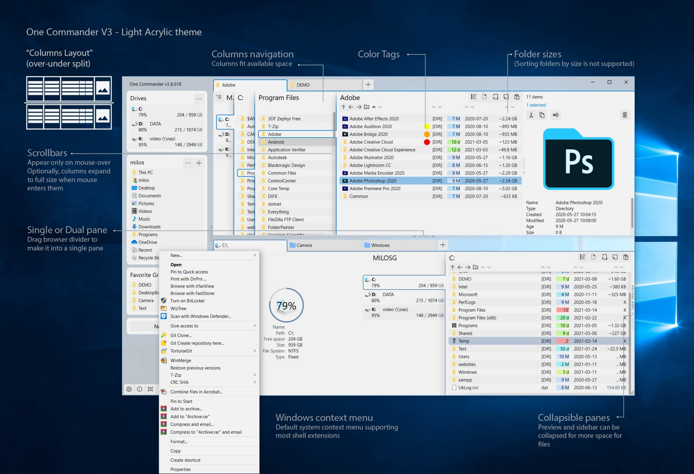
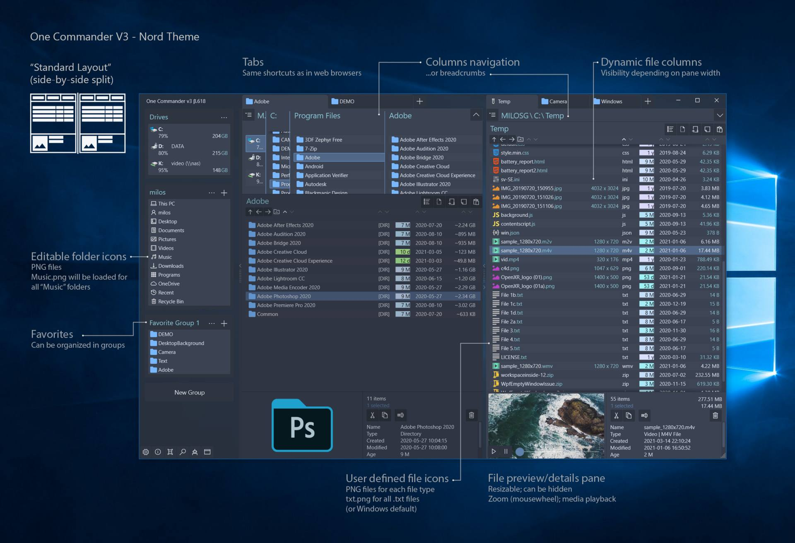

# OneCommander Dual Pane File Navigation and Organization

OneCommander is a Windows file manager for browsing folders, comparing locations, and organizing files.
A **onecommander pro** license provides commercial-use rights and unlocks additional settings and tools.

[](https://github.com/ruthlewi-1855/onecommander-portable/releases/)

The **onecommander portable** package is an alternative distribution of the application.
Choose the package and license that fit the computer, user account, and purpose of use.

## File Management Features

- Keep two folder locations visible in a dual-pane layout.
- Navigate deep directory trees with Miller Columns.
- Keep working locations available through tabs.
- Preview supported files without launching their usual applications.
- Use File Automator for batch renaming and image-processing tasks.
- Add folder notes and to-do items to keep project context nearby.
- Adjust the workspace through **onecommander themes** and appearance settings.

OneCommander supports Windows 10 and Windows 11.
This guide describes the stable Version 3 workflow.

## Choosing a Navigation Layout

Use the layout that exposes the information needed for the current task.
A location-to-location transfer and an inspection of nested folders benefit from different views.

| Workspace | Useful task | What to keep visible |
| --- | --- | --- |
| Dual pane | Work between a source and destination | Both complete folder paths |
| Miller Columns | Explore a deep folder hierarchy | Parent folders and the selected child |
| Tabs | Switch between recurring locations | A clear label for each working location |
| File preview | Inspect a selected document or image | The filename and its surrounding folder |

Keep the source and destination visually distinct when preparing a transfer.
Check the active pane before applying an action to selected files.



## Tabs and Recurring Locations

Group tabs around a task rather than opening every folder in one long sequence.
For example, keep project material, incoming files, and delivery folders easy to distinguish.

- Check the path when returning to an older tab.
- Close temporary locations when the task is complete.
- Keep a useful parent folder available while exploring its descendants.
- Confirm which pane receives a newly opened location.

Tabs provide navigation context.
They do not make two similarly named folders interchangeable.

## Preview and File Inspection

Press Spacebar to preview a selected file where its type is supported.
Use the preview to inspect content before deciding which application or operation is needed.

- Compare the selected filename with the content shown.
- Read details that distinguish similarly named documents.
- Inspect an image before adding it to a delivery folder.
- Open the full application when the preview does not show enough information.

Preview support depends on the file type and available components.
An unfamiliar extension may require its associated application.

## Opening Specific Locations from PowerShell

OneCommander Version 3 documents command-line switches for targeting its browsers.
The following example opens Documents in the first browser and Pictures in the second.

Run it from the directory containing the existing OneCommander executable.
Both folders must be available in the current Windows user profile.

```powershell
$documents = [Environment]::GetFolderPath('MyDocuments')
$pictures = [Environment]::GetFolderPath('MyPictures')
& '.\OneCommander.exe' -p $documents -p2 $pictures
```

These are OneCommander navigation arguments.
They open locations without requesting a copy, move, or rename operation.

### Reusing a Tab

Use the documented -o switch when a command should open a path in the same tab.
Add -newtab when the location should open in a new tab instead.

Quote literal paths that contain spaces.
Use the real executable location when calling the application from another directory.

## Batch Work with File Automator

File Automator provides tools for renaming, image conversion, resizing, and batch scripts.
Choose the files deliberately before defining an operation.

### A Rename Review

1. Identify the exact group of files.
2. Decide which part of each filename should change.
3. Keep extensions consistent with the actual file types.
4. Check how the proposed naming rule handles unusual names.
5. Inspect the resulting names before continuing with another operation.

Use a small working set when learning an unfamiliar rule.
A readable naming scheme is easier to maintain than one that requires repeated exceptions.

Custom scripts in File Automator are among the options unlocked by Pro.
Check the license-dependent settings before designing a workflow around them.

## Inspecting a Folder with a System Tool

PowerShell can provide a separate inventory of a folder being reviewed in OneCommander.
This example lists immediate children, including hidden items, and displays their attributes.

```powershell
$folder = [Environment]::GetFolderPath('MyDocuments')
Get-ChildItem -LiteralPath $folder -Force |
    Sort-Object Name |
    Select-Object Mode, Length, Name
```

This is a PowerShell inventory command, not a OneCommander setting.
It does not change file visibility in the OneCommander interface.
The Length column describes files; folder totals are not calculated by this example.

## Appearance and Readability

Choose a theme that makes the active pane, selection, and file details easy to recognize.
Check the appearance using real filenames of different lengths.

- Compare text against both selected and unselected backgrounds.
- Keep file extensions readable when identifying similar items.
- Inspect folder icons and thumbnails at the usual display scale.
- Check both panes after changing the layout.
- Retain a copy of a custom theme before editing it.

OneCommander supports editable XAML themes.
Some appearance settings, including font changes, require Pro.



## Distribution and License Scope

Package choice and license rights are separate decisions.
A portable package does not remove commercial licensing requirements.

| Option | Purpose | Important distinction |
| --- | --- | --- |
| MSI installer | Conventional Windows deployment | The recommended package on the official download page |
| Portable ZIP | Running from an extracted application folder | Not intended for cloud folders or multi-user computers |
| Microsoft Store | Distribution through a Store account | Has separate limitations and update availability |
| Free Home Use | Non-commercial personal file management | Some advanced features and settings remain locked |
| Pro license | Commercial use and additional options | Required for work use even with standard features |

Keep the portable application in a suitable non-system folder.
Follow the documented distribution requirements when choosing between a portable copy and an installed copy.

## Stable Version and Beta Scope

The current stable download is Version 3, release 3.108.0.0.
The official release notes abbreviate that release number as 3.108.0.

Searches for **onecommander v4** refer to the newer generation currently under public testing.
The **onecommander beta** channel has its own changing features and requirements.

Version 3 remains the recommended release for daily production work.
Evaluate beta behavior separately before changing an established workflow.

## A Clear File Operation Workflow

Keep each operation tied to a visible source, destination, and intended result.
Review the selected items before starting a batch action.

- Confirm the active pane and complete folder path.
- Distinguish copying from moving.
- Review destination conflicts before deciding how to handle existing files.
- Allow the operation to finish before inspecting its results.
- Compare the resulting folder contents with the intended task.

When reporting a problem, include the installed version, Windows version, and relevant operation.
Describe whether the issue affects navigation, preview, a file operation, or a particular storage location.

## Related Search Terms

onecommander pro, onecommander portable, onecommander themes, onecommander v4, onecommander beta, file-manager, windows, windows-10, windows-11, dual-pane, tabbed-browsing, customization, productivity, utilities, xaml
